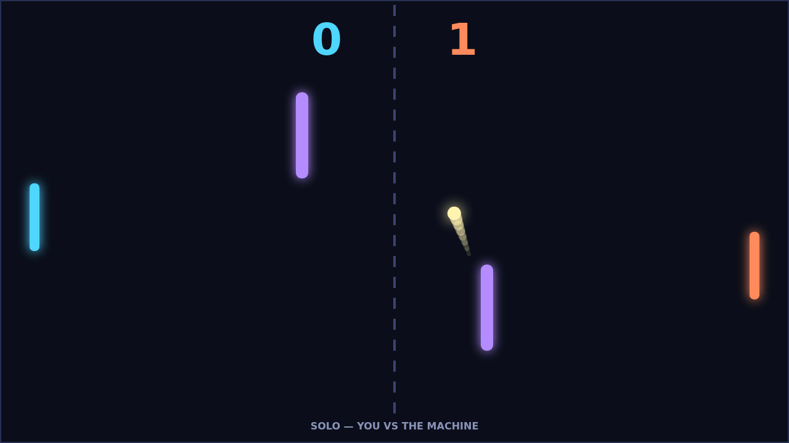
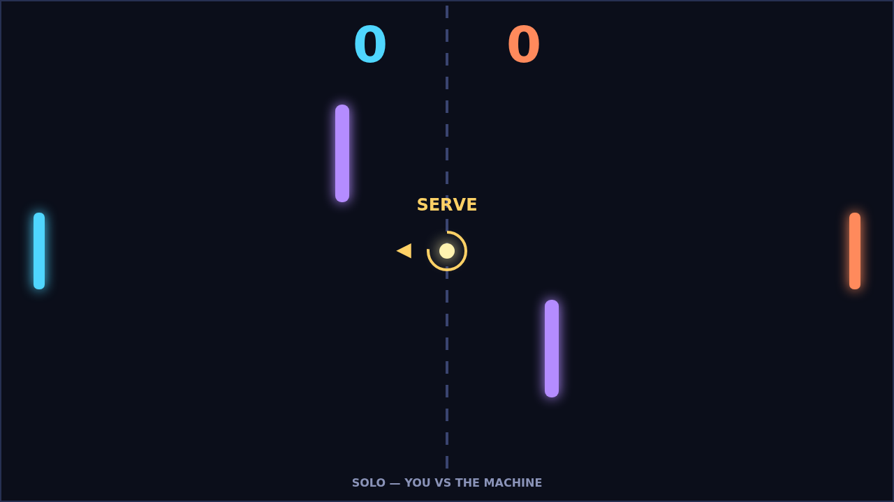

# Carom

Carom is a top-down paddle duel played in the browser. Two glowing paddles face
each other across a dark field, a ball ricochets between them, and two bars
stand in the middle of the field waiting to deflect anything that comes near.
Score by putting the ball past the far edge behind your opponent's paddle.
Play the machine in Solo, or share a keyboard with a friend in Versus.

Every match opens the same way: the ball waits at the center for a beat, then
serves toward player one at a shallow angle. The opening rally is a feeling-out
exercise. The ball is at its slowest, straight returns come back straight, and
both players learn how far the obstacles reach. Then someone strikes the ball
with a moving paddle, and the match changes.

That is Carom's spin. The motion of your paddle at the moment it meets the ball
bends the ball's flight afterward: sweep downward as you hit and the ball curls
one way, sweep upward and it curls the other. Spin fades over a second or so,
but it survives every wall and obstacle bounce, so a ball you curve into a bar
comes off it still curving. Where you hit the ball on the paddle sets its angle,
and every paddle hit adds a little speed, so a long rally climbs toward the speed
cap and the window to read a curve gets narrower each time.

The obstacles turn the field into a bank-shot puzzle. A straight shot across the
middle is easy to read. A shot that clips the near bar, spins off it, and
arrives at the far paddle from an angle nobody was covering is not. The best
points in a match are the ones where you aim at the bar on purpose.

A match is first to eleven, winning by two, so a 10-10 score means the match
goes on until someone pulls two clear. Pause any time with P or Escape, and
toggle sound with M.
